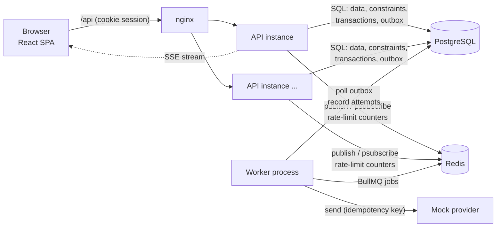
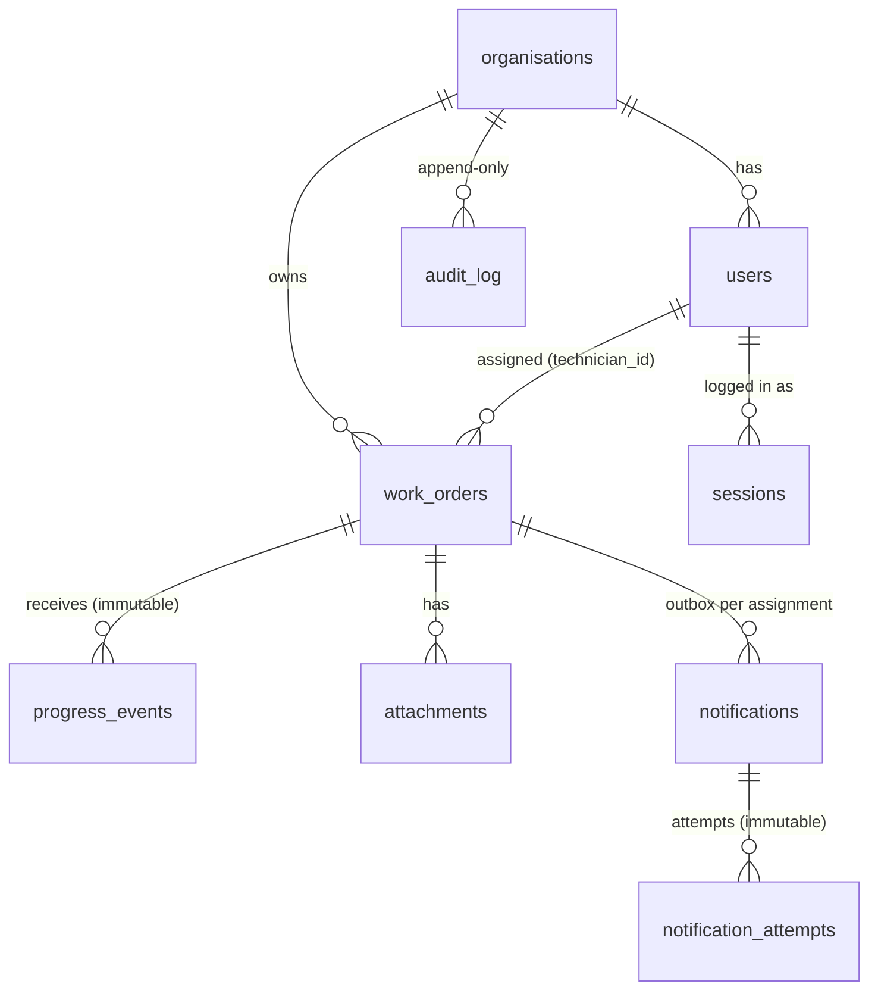

# FieldDesk technical notes

This document explains how FieldDesk is built, why, and where it stops. The single most important design decision is that **every correctness guarantee lives in PostgreSQL**, not in application memory. That is what keeps the system correct with any number of API and worker processes.

## Contents

1. [Architecture](#1-architecture)
2. [Folder structure](#2-folder-structure)
3. [Database model](#3-database-model)
4. [Authentication, authorisation and tenant isolation](#4-authentication-authorisation-and-tenant-isolation)
5. [Scheduling and concurrency](#5-scheduling-and-concurrency)
6. [Progress events: idempotency and transaction boundary](#6-progress-events-idempotency-and-transaction-boundary)
7. [Attachments and storage](#7-attachments-and-storage)
8. [Background processing](#8-background-processing)
9. [Real-time updates](#9-real-time-updates)
10. [Audit history](#10-audit-history)
11. [Reporting (CSV)](#11-reporting-csv)
12. [API and operational quality](#12-api-and-operational-quality)
13. [Testing](#13-testing)
14. [Scaling](#14-scaling)
15. [Deployment and monitoring](#15-deployment-and-monitoring)
16. [Backup and recovery](#16-backup-and-recovery)
17. [Assumptions](#17-assumptions)
18. [Limitations and incomplete areas](#18-limitations-and-incomplete-areas)

---

## 1. Architecture



| Component | Responsibility | Holds state? |
|---|---|---|
| **React SPA** | UI only. Never a security boundary. | No |
| **API** (Express) | Auth, validation, authorisation, transactions, SSE fan-out. | No (stateless; sessions are in PostgreSQL) |
| **Worker** | Outbox relay, notification delivery, retries, maintenance. | No |
| **PostgreSQL** | Source of truth. Enforces overlaps, idempotency, quota, immutability, tenant-safe references. | Yes |
| **Redis** | BullMQ queue, real-time pub/sub between API instances, shared rate-limit counters, mock-provider state. | Yes, but recoverable (see §8 and §16) |

**Shared code.** `shared/` holds what both the API and the worker need: config, the database pool and transaction helper, logger, Redis factory, audit writer and real-time publisher. Both projects bundle it with `tsup`, so each container stays self-contained.

**Why these libraries.**
- **Express 5** passes async errors to the error middleware without wrappers.
- **Plain `pg` with hand-written SQL** keeps the queries reviewers care about visible instead of hidden behind an ORM: exclusion constraints, `FOR UPDATE`, `SKIP LOCKED`, `ON CONFLICT`, streaming cursors.
- **Zod** gives one validation layer, and it also validates configuration.
- **BullMQ** provides retries, backoff hooks and a clean permanent-failure signal (`UnrecoverableError`).

## 2. Folder structure

The top-level layout follows the brief. A `shared/` directory was added for code used by both the API and the worker. `backend/src` is organised by feature module: each module owns its routes, schemas, queries and service logic. Cross-cutting concerns live in `middleware/` and `lib/`. The README has the full tree.

## 3. Database model



| Table | Purpose and notable rules |
|---|---|
| `organisations` | Tenant. `storage_limit_bytes`, `storage_used_bytes` (CHECK `0 ≤ used ≤ limit`), `work_order_seq` for per-org references. |
| `users` | Global unique email (case-insensitive). `role` ∈ owner/dispatcher/technician. `UNIQUE (org_id, id)` is the target of composite foreign keys. |
| `sessions` | SHA-256 of the session token, expiry. Server-side, so logout and deactivation revoke immediately. |
| `work_orders` | Per-org unique `reference` (WO-00001). `version` for optimistic locking, `assignment_version` for notification de-duplication. Composite FKs `(org_id, technician_id)` and `(org_id, created_by)`. **Exclusion constraint** against overlapping technician windows (§5). Generated `search_text` column with a trigram index. |
| `progress_events` | `UNIQUE (org_id, event_id)`. Stores the canonical request hash and the original result. UPDATE and DELETE are rejected by a trigger. |
| `attachments` | Opaque `storage_key`, sanitised display filename, sniffed content type, size. |
| `notifications` | Transactional outbox and delivery state. `dedupe_key` UNIQUE = `<workOrderId>:assignment:<assignmentVersion>`. |
| `notification_attempts` | One row per delivery attempt, with outcome, error and duration. Append-only. |
| `audit_log` | Organisation, actor (user or system), action, target, `work_order_id`, before/after JSON, request ID, timestamp. Append-only. |

**Indexes** cover every list filter and sort, scoped by organisation first: `(org_id, status)`, `(org_id, priority)`, `(org_id, technician_id, scheduled_start)`, `(org_id, scheduled_start)`, `(org_id, created_at)`, `(org_id, updated_at)`. Search uses a GIN trigram index, and the exclusion constraint has its own GiST index. There are also a partial index for pending outbox rows and audit indexes by work order and by time.

**Migrations** are plain SQL files in `database/migrations`, applied in filename order by a small runner (`backend/src/db/migrator.ts`). Each file runs in its own transaction. A PostgreSQL advisory lock prevents two replicas migrating at the same time. `/readyz` reports pending migrations.

## 4. Authentication, authorisation and tenant isolation

**Passwords** are hashed with argon2id. Login verifies against a dummy hash when the email is unknown, so response timing does not reveal which emails exist, and both failures return the same `401 INVALID_CREDENTIALS`.

**Sessions.**
- A 256-bit random token is set in an `httpOnly`, `SameSite=Strict` cookie (`Secure` when `COOKIE_SECURE=true`).
- Only its SHA-256 is stored in `sessions`, so a database leak does not expose live sessions.
- Every request resolves the session **joined to `users`**. Organisation and role are re-read on every request, so a role change or deactivation applies on the very next call.
- Logout deletes the row, so a copied cookie stops working. Deactivating a user deletes all of their sessions.

Server-side sessions were chosen over JWTs because revocation is immediate and there is no signing key to manage. The cost is one indexed lookup per request.

**CSRF.** `SameSite=Strict`, plus an Origin check on state-changing requests (`TRUSTED_ORIGINS`).

**Authorisation is two-layered, both on the server.**
1. **Role permissions.** One map, `backend/src/lib/permissions.ts`, enforced by `requirePermission()` on every route.
2. **Row scope.** Every query takes a `Scope` built only from the session: `orgId` always, plus `technicianId` when the caller is a technician (`repository.ts → scopeOf()`). All reads and writes include `WHERE org_id = $scope` (and the technician filter where relevant).

**Never trusting the client.**
- Request schemas are `.strict()`, so a body containing `orgId`, `createdBy`, `role` or `status` on create is rejected with 400, not silently ignored.
- There is no endpoint that takes an organisation ID.
- IDs in URLs are UUID-validated and then looked up *inside the caller's scope*.
- Another organisation's ID is indistinguishable from a non-existent one (`404`), which avoids confirming that it exists.

**Defence in depth in the schema.** Composite foreign keys such as `(org_id, technician_id) → users(org_id, id)` make it impossible to store a cross-tenant reference even if a query were wrong. There is a test that tries exactly that with raw SQL.

**The frontend** hides actions a role cannot take, but only as a convenience. `/auth/me` returns the permission list for that purpose, and the API enforces the same rules regardless.

## 5. Scheduling and concurrency

The guarantee is a PostgreSQL **exclusion constraint**:

```sql
CONSTRAINT work_orders_no_technician_overlap EXCLUDE USING gist (
  technician_id WITH =,
  tstzrange(scheduled_start, scheduled_end, '[)') WITH &&
) WHERE (technician_id IS NOT NULL AND status NOT IN ('completed','cancelled'))
```

**Why it is correct under concurrency, and across instances.** PostgreSQL checks the constraint atomically inside the index for every INSERT or UPDATE. If two transactions try to book overlapping windows, the second blocks on the first one's uncommitted index entry. When the first commits, the second fails with SQLSTATE `23P01`. It makes no difference whether the two requests came from the same process, two API replicas or two data centres sharing the database: no application lock, cache or "check then write" is involved. Windows are half-open (`[start, end)`), so back-to-back jobs are allowed.

**Request flow** (`work-orders/service.ts → assignWorkOrder`), all in one transaction:
1. Lock the work order (`SELECT … FOR UPDATE`, scoped to the organisation). This serialises edits to the same work order and makes optimistic `version` checks reliable.
2. Validate that the technician belongs to the same organisation, is a technician, and is active. `FOR SHARE` blocks a concurrent deactivation.
3. **Friendly pre-check.** Look for an overlapping booking and, if found, return `409 SCHEDULE_CONFLICT` with the conflicting work order's reference and window. This only exists for the error message; correctness does not depend on it.
4. `UPDATE`. The constraint is the real guard. If a concurrent transaction slipped past step 3, `23P01` is mapped to the same `409 SCHEDULE_CONFLICT`. If both transactions wrote their conflicting rows before either checked, each waits on the other and PostgreSQL aborts one with a deadlock (`40P01`). The victim was fully rolled back, so the service retries it in a fresh transaction (up to 3 attempts); the retry sees the winner and returns the normal 409. Without the retry, the loser got `503 BUSY_RETRY` instead (found when running the suite on Windows + Docker, where the race was hit 27 times in 5 runs).
5. Write the audit entry and the outbox notification, then COMMIT.

**Validation of windows.** Both start and end are required together, end must be after start, a window cannot exceed 14 days, timestamps need a timezone, and a technician can only be assigned with a schedule. These rules exist in Zod and as CHECK constraints.

**Assumption.** Completed and cancelled work orders no longer block a technician's time, which the constraint's `WHERE` clause expresses.

**Tests** (`tests/scheduling-concurrency.test.ts`):
- Two separate API instances (separate Express apps, Redis clients and connection pools, sharing only PostgreSQL) fire conflicting assignments simultaneously, 10 rounds. Exactly one succeeds each round, and a final SQL query proves that no overlaps exist.
- Six simultaneous creations for the same slot produce exactly one row; the losers leave nothing behind.
- A raw-SQL insert bypassing the application is rejected by the constraint.

## 6. Progress events: idempotency and transaction boundary

`POST /api/progress-events` (technicians only, rate-limited per user). Implementation: `backend/src/modules/events/routes.ts`.

**Validation.** The entire body is untrusted. A Zod discriminated union on `type` covers `status_changed` and `note_added`, with strict objects at every level, so unknown fields are rejected.
- `eventId`: 1–100 characters from `[A-Za-z0-9._:-]`.
- `workOrderId`: UUID.
- `occurredAt`: ISO-8601 with an offset, not more than 5 minutes in the future (allowed clock skew), not before the year 2000.
- Payload: technicians may only set `in_progress`, `on_hold` or `completed`, and notes are capped at 1,000 characters.

**Idempotency mechanism.**
- `eventId` is unique per organisation: `UNIQUE (org_id, event_id)`.
- The stored row keeps a SHA-256 of the canonical request (actor, work order, type, normalised timestamp, payload with sorted keys) and the **original result**.
- A repeat of the identical request returns `200` with the stored result and `"duplicate": true`. The work order is not touched again.
- The same `eventId` with different content returns `409 EVENT_ID_REUSED`.

**Transaction boundary.** One transaction contains everything:

```
BEGIN
  SELECT work order FOR UPDATE WHERE id AND org_id AND technician_id = caller   -- authorisation + serialisation
  SELECT existing event by (org_id, event_id)                                   -- re-check under the lock
  validate transition; UPDATE work_orders (status, version); INSERT audit entry
  INSERT progress_events ... ON CONFLICT (org_id, event_id) DO NOTHING          -- immutable record
  INSERT audit entry 'progress_event.accepted'
COMMIT
```

**Simultaneous duplicates.**
- All submissions for the same work order queue on its row lock. When the first commits, the next one's re-check (a new statement under READ COMMITTED) sees the committed event and replays it.
- If a duplicate somehow reaches the INSERT, the unique constraint returns no row. The handler then throws, which rolls back everything that transaction had done, and returns the winner's stored result.
- Tested with 10 parallel identical submissions: one `201`, nine `200`, a single event row, a single status change, and the version incremented once.

**No partial changes.**
- An invalid transition (e.g. open → completed) returns `409 INVALID_TRANSITION` and stores nothing, so the client can correct the event and reuse the same `eventId`.
- A test-only failpoint throws *after* the work-order UPDATE and its audit row. The test proves that the status, audit log and event table are all unchanged, and that a retry of the same `eventId` then succeeds exactly once.
- Accepted events are immutable: a trigger rejects UPDATE and DELETE.

## 7. Attachments and storage

Flow (`backend/src/modules/attachments/routes.ts`):
1. **Authorise before reading the body.** A caller who cannot see the work order gets `404` before any bytes are accepted.
2. Multer streams the upload to a temp directory under a random name, with a hard `MAX_UPLOAD_BYTES` limit (`413 FILE_TOO_LARGE`).
3. **The type comes from the file's magic bytes** (PNG, JPEG, WebP, PDF). The declared MIME type and extension are ignored, so `invoice.pdf` that is really an EXE is rejected with `415`.
4. One transaction:
   - Lock the work order.
   - **Atomically reserve quota**: `UPDATE organisations SET used = used + size WHERE id = $org AND used + size <= limit`. No row back means `413 STORAGE_QUOTA_EXCEEDED`. Concurrent uploads serialise on the organisation row, so the limit cannot be overshot, and a CHECK constraint backs this up.
   - Insert the metadata row and the audit entry.
   - Move the file into permanent storage as the last step before COMMIT.
5. The temp file is always removed.

**Safe identifiers.** The storage key is `<orgId>/<uuid>`, generated on the server. The client filename is kept only as sanitised display text (path components and control characters stripped). The storage layer re-validates keys against a strict pattern and refuses anything that would resolve outside its root.

**No path exposure.** API responses contain an ID, display name, type, size and a download URL. The storage key and filesystem paths never leave the storage module.

**Download.** `GET /api/attachments/:id/download` joins through the work order, so technicians can only fetch files on work assigned to them, and other organisations get `404`. Responses are sent with `Content-Disposition: attachment`, `X-Content-Type-Options: nosniff`, a sandboxing CSP and `Cache-Control: private, no-store`.

**Replacing local disk with object storage.** Everything goes through the `StorageProvider` interface (`storage.ts`). An `S3StorageProvider` would implement:
- `put` as `PutObject` (multipart for large files) into a **private** bucket with server-side encryption and keys `<orgId>/<uuid>`;
- `openRead` as `GetObject` streaming, or the download route would return a short-lived **pre-signed GET URL** after the same authorisation check;
- `delete` as `DeleteObject`.

For large files the upload would switch to a pre-signed PUT straight from the browser, followed by a "complete" call that verifies size and type (`HeadObject` plus a ranged GET of the first bytes) before reserving quota. Lifecycle rules would clean up abandoned uploads, and bucket versioning would protect against accidental deletes. The database model would not change.

**Gap.** Deleting attachments is not implemented, so quota is never released (see §18).

## 8. Background processing

**Enqueue without loss: the transactional outbox.**
- When a technician is assigned (on create or reassignment), a `notifications` row is inserted **in the same transaction** as the assignment.
- A committed assignment therefore always has its notification, and a rolled-back or conflicting assignment never produces one (tested).
- `dedupe_key = <workOrderId>:assignment:<assignmentVersion>` is UNIQUE, so one assignment can only ever create one notification record. Rescheduling the same technician is not a new assignment.

**Relay.** The worker polls `status = 'pending'` rows with `FOR UPDATE SKIP LOCKED`, so several worker processes share the work without collisions. It adds each row to BullMQ with **`jobId = notification id`** and then marks it `enqueued`. If the worker crashes between `add()` and the update, the next relay re-adds the row, and BullMQ ignores a duplicate `jobId` (tested).

**Delivery** (`worker/src/notify.ts`):
- The notification row is locked `FOR UPDATE` for the whole attempt. If BullMQ re-runs a stalled job while the original is still working, the second run waits, sees `delivered` and **skips**.
- The provider receives the `dedupe_key` as an **idempotency key**. This covers the last gap: if the provider accepted the message but the worker died before COMMIT, the retry is recognised by the provider and recorded as `duplicate_suppressed` instead of sending twice (tested).
- Every attempt is written to `notification_attempts` (attempt number, outcome, error, duration).
- Final outcomes (`notification.delivered` / `notification.failed` with reason `permanent` or `retries_exhausted`) go to the audit log as **system** actions.
- Dispatchers see the status on the work-order page, updated live.

**Temporary vs permanent.**

| Situation | Classification | Behaviour |
|---|---|---|
| Provider timeout, 5xx/429, network error, unknown exception | Temporary | BullMQ retries with **exponential backoff with jitter** (base 1 s, doubling, capped at 5 min, equal jitter) up to `NOTIFY_MAX_ATTEMPTS` (default 5), then `failed` with reason `retries_exhausted` |
| Invalid recipient, provider rejection (4xx) | Permanent | `UnrecoverableError`: no retries, `failed` immediately |
| Malformed job payload, missing notification | Permanent | Same |

Unknown errors are treated as temporary: retrying a few times is cheaper than silently dropping a notification.

**Mock provider.** State lives in Redis, so it is shared by all workers. Modes are `success`, `temporary_failure`, `permanent_failure` and `flaky` (fail N times, then succeed). They can be set globally at runtime (`mock-provider` CLI) or per recipient (`+tempfail` / `+permfail` in the address, used by two seeded technicians). Real deliveries are appended to a Redis list, which is what the tests count.

**Diagnostic logs.** Structured JSON lines include `jobId`, `notificationId`, `dedupeKey`, `attemptNo`, `maxAttempts`, `outcome`, `durationMs`, `error` and `willRetry`. The original request ID is embedded in the notification body.

**Recovery and maintenance.** Every minute the worker re-adds any `enqueued`/`retrying` notification older than 10 minutes whose job no longer exists in Redis (protection against Redis data loss), and deletes expired sessions.

**Shutdown.** On SIGTERM the relay loop stops, `worker.close()` waits for active jobs to finish, and connections close. Unfinished jobs stay in Redis for the next worker.

## 9. Real-time updates

**Transport.** Server-Sent Events at `GET /api/realtime/stream`. SSE is one-directional (exactly what is needed), works through ordinary HTTP proxies, reconnects automatically in the browser, and authenticates with the existing session cookie.

**Authentication.** The stream goes through the same `authenticate` middleware, so there is no stream without a valid session (`401`). Every heartbeat (25 s) re-validates the session: after logout or deactivation the server sends `session_expired` and closes the stream.

**Organisation isolation.**
- After a committed change, the API publishes to the Redis channel `fd:rt:org:<orgId>`.
- Each API instance has one pattern subscription and routes a message only to local connections whose **session-derived** `orgId` equals the channel's organisation. The client never chooses a channel.
- Messages whose payload `orgId` disagrees with the channel are dropped and logged.
- Technicians additionally receive only events that list them as the old or new assignee.
- Payloads are minimal (type, work-order ID, reference, status, time). Clients refetch the details through the normally authorised API, so a real-time message can never leak more than the API would.
- Tested with four SSE clients across two API instances and two organisations.

**Reconnection.**
- The server sends `retry: 3000` and the browser `EventSource` reconnects by itself.
- Because events are not replayed, the client **refetches all of its data after any reconnect**. During graceful shutdown the API tells clients to reconnect, and they land on another instance.

**When real-time delivery is unavailable.**
- If an API instance's Redis subscriber drops, the instance tells its clients `status: degraded`. If the client cannot reach the stream at all, `EventSource` reports an error.
- In both cases the header shows "Live updates paused" or "Reconnecting…", and every live query falls back to **polling every 30 seconds**. When the subscription recovers, clients get `status: ok` and refetch.
- Publishing happens *after* COMMIT and is best-effort: a Redis outage never fails or rolls back a user's write. The database stays the source of truth, so the worst case is a delay of up to 30 seconds, never wrong data.
- `/readyz` reports real-time as `degraded` but does not fail readiness, because the API still serves correct data.

## 10. Audit history

`audit_log` records work-order creation, edits (only the changed fields, before and after), assignment changes, status changes (with the note and whether it came from the API or a progress event), accepted progress events, attachment additions, user creation, role changes, activation changes, organisation updates, notification outcomes (as `system` actor), and logins and logouts.

Each entry has: organisation, actor type and ID, action, target type and ID, work order, before/after JSON, metadata, the request correlation ID, and a timestamp.

**Not editable.** There is no write endpoint, and the API exposes the log read-only: per work order to anyone who can see that work order, and organisation-wide to owners. A trigger rejects UPDATE and DELETE for every database client (tested). Entries are written **in the same transaction** as the change they describe, so the log can never claim something that was rolled back.

## 11. Reporting (CSV)

`GET /api/work-orders/export.csv` takes the same query parameters as the list endpoint and uses the **same `buildListQuery()`**, so filters, sort and authorisation scope (organisation, and technicians are not allowed to export) are identical by construction.

**Memory.** Rows come from a server-side cursor (`pg-query-stream`, 200 rows per fetch) and pass through a CSV stringifier into the response with back-pressure, so memory stays flat regardless of size. The `pipeline()` tears the cursor down if the client disconnects. A test exports 5,000 rows.

**Formula injection.** Any cell starting with `=`, `+`, `-`, `@`, tab or carriage return is prefixed with `'`, following OWASP guidance, and every field is quoted.

**Isolation test.** `tests/csv-export.test.ts` checks that each organisation's export contains only its own rows.

## 12. API and operational quality

| Requirement | Implementation |
|---|---|
| Centralised validation | Zod schemas plus `parseBody`, `parseQuery` and `parseParams`. ZodError becomes `400 VALIDATION_FAILED` with `details: [{ path, message }]`. |
| Consistent errors | `{ error: { code, message, details?, requestId } }` from one error handler. PostgreSQL errors are mapped (`23P01` → 409, lock timeout → 503 `BUSY_RETRY`). Unknown errors return a generic 500 and the stack trace goes only to the logs. |
| Correlation IDs | Reuses a well-formed incoming `X-Request-Id`, otherwise generates a UUID. Returned in a header and in error bodies, attached to every log line, stored on audit entries. |
| Structured logging | pino JSON with service name and request ID, plus user/org/role once authenticated. Cookies, authorisation headers and passwords are redacted. |
| Health / readiness | `/healthz` = the process is up. `/readyz` = database, migrations, Redis, and not shutting down (returns 503 otherwise). |
| Graceful shutdown | On SIGTERM: readiness fails, the server stops accepting connections, SSE clients are told to reconnect, in-flight requests finish, then Redis and the pool close, with a hard deadline. The worker waits for active jobs. Both verified manually on the built output. |
| Configuration | One Zod-validated schema (`shared/config.ts`). Invalid config exits at startup with a clear list. |
| Migrations and seed | See §3. Seed: 2 organisations, all roles, sample work orders. |
| Rate limiting | Redis-backed (shared across instances). Login: per IP, failed attempts only (10 per 15 min). Progress events: per user (120/min). If Redis is down the limiter fails open and logs, so login is not taken offline. |
| Indexes | See §3. |
| Secrets | `.env` is git-ignored. `.env.example` and `docker-compose.yml` contain only local placeholders, overridable via `.env`. |
| Security headers | helmet (`nosniff`, frame protection and others). `x-powered-by` is removed. |
| Transactions | `withTransaction()` sets `lock_timeout = 5s` so lock waits fail fast instead of hanging. |

## 13. Testing

`npm test` runs **117 API and worker integration tests**, 3 full-stack frontend workflow tests and 5 frontend unit tests (125 in total). They use **real PostgreSQL and Redis**, the real migrations, the real Express app and the real BullMQ. Mocks are not used to assert behaviour.

| Required area | Where |
|---|---|
| Successful and failed authentication, logout, revocation, rate limit | `auth.test.ts` |
| Role restrictions | `roles.test.ts` |
| Cross-organisation access (IDs, URLs, payloads, composite FKs) | `tenant-isolation.test.ts` |
| Cross-organisation real-time isolation (2 instances, 2 orgs) | `realtime.test.ts` |
| Work-order validation, lifecycle, list features, audit immutability | `work-orders.test.ts` |
| Concurrent scheduling conflicts (2 API instances) | `scheduling-concurrency.test.ts` |
| Duplicate and concurrent event submission | `progress-events.test.ts` |
| Transaction rollback (failpoint after UPDATE; rejected transition) | `progress-events.test.ts` |
| Attachment type, size, quota (including concurrent uploads), access control | `attachments.test.ts` |
| Worker retries, permanent failure, exhausted retries, duplicate delivery (relay, concurrent workers, crash after send) | `worker.test.ts` |
| Organisation-scoped CSV export and formula injection | `csv-export.test.ts` |
| Important frontend workflow | `frontend-workflow.test.tsx` |
| Operational behaviour (health, readiness, correlation IDs, error format, origin check) | `operations.test.ts` |

**The frontend workflow test** renders the real React app in jsdom against a real API server on a real port with the real database. Only the browser cookie jar is emulated, because Node's `fetch` has none. It covers: sign in → validation messages → create and schedule a work order → attempt to double-book the technician on another work order → the conflict message names the clashing work order → the database is unchanged → a non-overlapping slot saves. This test caught a real bug during development: the query cache was cleared on login in a way that left the UI on the sign-in screen.

Test files run one at a time and reset the shared test database. Concurrency is exercised *inside* tests with `Promise.all` over separate connections and separate API instances.

## 14. Scaling

- **API** is stateless: run N replicas behind a load balancer. Sessions, quotas, idempotency and overlap rules are all in PostgreSQL. Rate limits and real-time fan-out are in Redis. No sticky sessions are needed, and SSE clients may land on any instance.
- **Worker**: run N replicas. `SKIP LOCKED` spreads the relay work, BullMQ distributes jobs, and the row lock plus idempotency key prevent duplicates. Concurrency per process is configurable.
- **PostgreSQL**:
  - Add PgBouncer in transaction mode when replica count × pool size approaches `max_connections`. The code uses no session-level state outside a transaction; the migration advisory lock should then run on a direct connection.
  - Move read-heavy endpoints (list, summary, export) to a read replica.
  - The audit log and progress events grow without bound; partition them by month and archive old partitions.
- **Hot spots**:
  - Per-organisation reference numbers and quota updates both lock the organisation row, briefly serialising creates and uploads within one organisation. That is fine at assessment scale; at high volume, use a per-org sequence table and keep quota in a separate row.
  - SSE holds one open connection per tab. Tune Node and nginx limits, or move fan-out to a dedicated gateway.
- **Search**: trigram `LIKE` is good up to a few million rows per organisation; beyond that, use PostgreSQL full-text search or an external index.
- **Row-level security** would be the next defence-in-depth step for isolation (§18).

## 15. Deployment and monitoring

- **Images**: three multi-stage images (API, worker, nginx with the SPA) running as non-root, with production-only dependencies. The API image has a `/readyz` healthcheck.
- **Platform**: any container platform (ECS/Fargate, Kubernetes, Cloud Run plus a worker service). Use managed PostgreSQL (RDS/Cloud SQL) with Multi-AZ and managed Redis (ElastiCache/Memorystore) with persistence. Terminate TLS at the load balancer and set `COOKIE_SECURE=true` and `TRUST_PROXY=true`. Configure secrets through the platform's secret manager, never in images.
- **Releases**:
  - CI runs lint, typecheck, tests (against service containers) and build, then pushes images.
  - Migrations run as a one-off job before the new API version rolls out (the `migrate` service shows the pattern). Migrations must be backwards compatible (expand, then contract).
  - Rolling deploys rely on readiness and graceful shutdown.
- **Monitoring**:
  - Ship JSON logs to a log platform and search by `requestId`.
  - Metrics to add: request rate, latency and error rate per route; `409 SCHEDULE_CONFLICT` rate; `429` rate; queue depth, delayed and failed job counts (BullMQ), and the age of the oldest `pending` notification; notification failure ratio; SSE connection count; database pool saturation and lock waits.
  - Alert on readiness failures, a stuck outbox (pending older than N minutes), a rising failed-notification rate, and 5xx rate.
  - OpenTelemetry tracing would carry the request ID into the worker.

## 16. Backup and recovery

- **PostgreSQL holds everything that matters.** Use automated daily snapshots plus continuous WAL archiving for **point-in-time recovery** (managed PITR, or `pgBackRest` / `wal-g` when self-hosted). Run regular restore drills into a scratch environment, verified by running migrations and a smoke test. Encrypt backups and keep copies in another region.
- **Attachments**: object storage with versioning and cross-region replication. A database restore to time T may reference objects deleted later; versioning lets them be restored. The reverse (objects without rows) is harmless and can be swept up.
- **Redis is not a source of truth.**
  - Queue: if lost, `pending` rows are re-relayed, and the maintenance task re-adds `enqueued`/`retrying` rows whose jobs vanished. Idempotency keys prevent duplicate sends.
  - Rate-limit counters and pub/sub are ephemeral.
  - AOF persistence is enabled in compose to reduce churn.
- **Audit and event tables** are append-only, which also makes tampering visible. Export them to cold storage for long-term retention.
- **Targets to agree with the business**, for example RPO ≤ 5 minutes (WAL) and RTO ≤ 1 hour.

## 17. Assumptions

These should also be raised as a GitHub Issue for confirmation.

1. **Owner is a superset of dispatcher.** Owners can also create, assign and update work orders; the brief lists only user and settings management for owners.
2. **`eventId` is unique per organisation.** Reusing an ID with different content is a `409`, not a new event.
3. **Only accepted events are stored.** A rejected event (validation, invalid transition, not assigned) is not recorded, so the client may correct it and reuse the ID.
4. **Completed and cancelled work orders free the technician's time.**
5. **Technicians can upload attachments** to, and download from, work orders assigned to them.
6. **Notifications are sent when the assigned technician changes** (create-with-technician or reassignment), not when the same technician is only rescheduled.
7. **The storage limit is set per organisation by the platform** (defaulting to `DEFAULT_ORG_STORAGE_LIMIT_BYTES`), not by the organisation's owner, who should not be able to raise their own quota. It is configurable in the database and by environment default.
8. **Email is globally unique**, which keeps login to email and password with no organisation selector.
9. **Technicians cannot be demoted or deactivated while they hold active work**, so their assignments are reassigned first.
10. **Timestamps are stored and exchanged in UTC (ISO-8601 with offset)**; the UI shows local time.
11. **Status flow**: open → in_progress / on_hold / cancelled; in_progress → on_hold / completed / cancelled; on_hold → in_progress / cancelled. Completed and cancelled are terminal. Starting work requires an assigned technician.

## 18. Limitations and incomplete areas

Each of these was a deliberate trade-off within the time box.

| Area | Gap | What would come next |
|---|---|---|
| Docker | The compose stack and Dockerfiles were written in an environment without Docker. **Since verified** on Windows 11 with Docker Desktop (engine 29.8.2): `docker compose up --build` built all three images and started every service with no changes needed; `migrate` applied the schema and seeded, `/readyz` reported all checks ok, and login, `/auth/me` and the work-order list worked through nginx on :8080. Not yet exercised in Docker: worker retries/permanent failure, uploads, SSE in a browser. | Run in CI |
| Browser E2E | The frontend workflow test runs the real app in jsdom against the real API. It is not Playwright in a real browser (no browser could be installed in the build environment). Visual layout was not reviewed in a browser by the AI. | A Playwright test in CI; manual responsive review |
| Attachments | No delete endpoint, so quota is never released. Uploads are buffered to local disk temp files. No antivirus scanning. | Delete with quota decrement in one transaction; scanning queue; S3 provider (§7) |
| Event replay | SSE does not replay missed events; clients refetch after reconnect. | `Last-Event-ID` with a per-organisation event log |
| Isolation depth | App-level scoping plus composite FKs, but no PostgreSQL row-level security. | RLS policies with `SET LOCAL app.org_id` per transaction |
| Sessions | No "log out other devices" UI and no password change or reset flow. | Self-service password management |
| Pagination | Offset pagination (simple, supports page numbers). Deep pages get slower. | Keyset pagination for very large organisations |
| Rate limiting | Login is limited per IP only, so a distributed attack on one account is not throttled per account. | Add a per-account limiter with backoff |
| Notifications | Only on technician assignment changes; no notification on reschedule or unassignment. | Configurable notification rules |
| Organisation settings | Only the name is editable. | Time zone, working hours |
| Audit log UI | Visible per work order (activity timeline); the organisation-wide log exists in the API (`/api/organisation/audit-log`) but has no screen. | Owner audit screen with filters |
