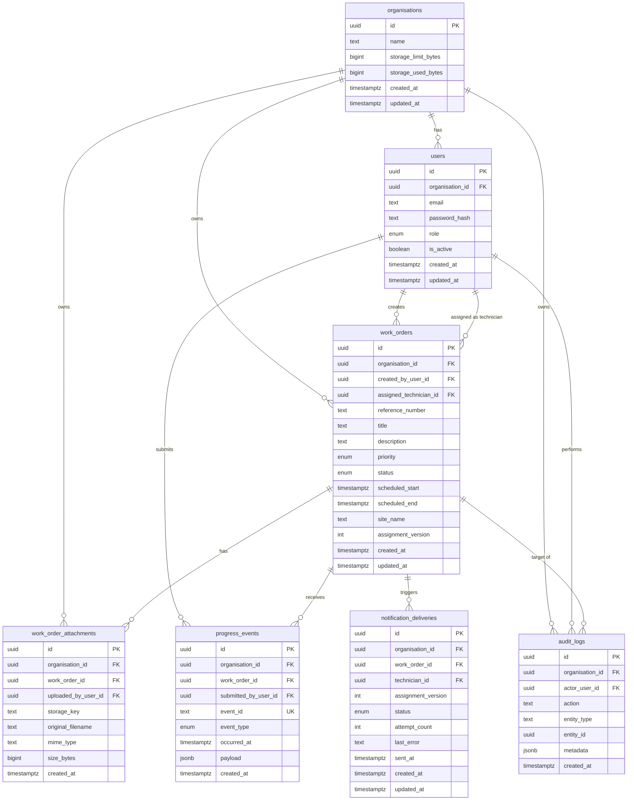

# Database schema — first pass (Phase 0)

Entity-relationship design for FieldDesk. This is the blueprint for Phase 1 migrations; column types may be refined during implementation.

**Related:** [ARCHITECTURE_DECISIONS.md](./ARCHITECTURE_DECISIONS.md)

---

## ERD (entity relationships)



---

## Tables

### `organisations`

Tenant root. Every other business row references an organisation.

| Column | Type | Constraints | Notes |
| --- | --- | --- | --- |
| `id` | `UUID` | PK, default `gen_random_uuid()` | |
| `name` | `TEXT` | NOT NULL | Display name |
| `storage_limit_bytes` | `BIGINT` | NOT NULL, default 104857600 (100 MB) | Configurable per org |
| `storage_used_bytes` | `BIGINT` | NOT NULL, default 0 | Updated on attachment add/delete |
| `created_at` | `TIMESTAMPTZ` | NOT NULL, default `now()` | |
| `updated_at` | `TIMESTAMPTZ` | NOT NULL, default `now()` | |

---

### `users`

One organisation per user. Email unique within an organisation.

| Column | Type | Constraints | Notes |
| --- | --- | --- | --- |
| `id` | `UUID` | PK | |
| `organisation_id` | `UUID` | NOT NULL, FK → `organisations.id` | Tenant scope |
| `email` | `TEXT` | NOT NULL | Normalised lowercase |
| `password_hash` | `TEXT` | NOT NULL | argon2 |
| `role` | `user_role` | NOT NULL | `owner`, `dispatcher`, `technician` |
| `is_active` | `BOOLEAN` | NOT NULL, default `true` | |
| `created_at` | `TIMESTAMPTZ` | NOT NULL | |
| `updated_at` | `TIMESTAMPTZ` | NOT NULL | |

**Indexes / constraints**

- `UNIQUE (organisation_id, email)`
- `INDEX (organisation_id, role)`

---

### `work_orders`

Central entity. Scheduling overlap enforced at DB level (see below).

| Column | Type | Constraints | Notes |
| --- | --- | --- | --- |
| `id` | `UUID` | PK | |
| `organisation_id` | `UUID` | NOT NULL, FK → `organisations.id` | |
| `created_by_user_id` | `UUID` | NOT NULL, FK → `users.id` | Creator |
| `assigned_technician_id` | `UUID` | FK → `users.id`, nullable | Must be same org (app + optional trigger) |
| `reference_number` | `TEXT` | NOT NULL | Human-readable ref, unique per org |
| `title` | `TEXT` | NOT NULL | |
| `description` | `TEXT` | | |
| `priority` | `work_order_priority` | NOT NULL, default `medium` | `low`, `medium`, `high`, `urgent` |
| `status` | `work_order_status` | NOT NULL, default `draft` | See enum below |
| `scheduled_start` | `TIMESTAMPTZ` | nullable | Required when status is `scheduled`+ |
| `scheduled_end` | `TIMESTAMPTZ` | nullable | Must be after `scheduled_start` |
| `site_name` | `TEXT` | NOT NULL | Job site label |
| `assignment_version` | `INT` | NOT NULL, default 1 | Incremented on each reassignment; used for notification dedupe |
| `created_at` | `TIMESTAMPTZ` | NOT NULL | |
| `updated_at` | `TIMESTAMPTZ` | NOT NULL | |

**Indexes / constraints**

- `UNIQUE (organisation_id, reference_number)`
- `INDEX (organisation_id, status, scheduled_start)` — list/filter
- `INDEX (assigned_technician_id, scheduled_start, scheduled_end)` WHERE `status NOT IN ('cancelled')`
- **Exclusion constraint** (requires `btree_gist`):

```sql
EXCLUDE USING gist (
  assigned_technician_id WITH =,
  tstzrange(scheduled_start, scheduled_end, '[)') WITH &&
)
WHERE (
  assigned_technician_id IS NOT NULL
  AND status NOT IN ('cancelled')
  AND scheduled_start IS NOT NULL
  AND scheduled_end IS NOT NULL
);
```

---

### `work_order_attachments`

File metadata. Binary stored on local disk at `storage_key`.

| Column | Type | Constraints | Notes |
| --- | --- | --- | --- |
| `id` | `UUID` | PK | |
| `organisation_id` | `UUID` | NOT NULL, FK → `organisations.id` | Denormalised for quota queries |
| `work_order_id` | `UUID` | NOT NULL, FK → `work_orders.id` ON DELETE CASCADE | |
| `uploaded_by_user_id` | `UUID` | NOT NULL, FK → `users.id` | |
| `storage_key` | `TEXT` | NOT NULL, UNIQUE | e.g. `{orgId}/{uuid}.pdf` |
| `original_filename` | `TEXT` | NOT NULL | Display only |
| `mime_type` | `TEXT` | NOT NULL | Validated on upload |
| `size_bytes` | `BIGINT` | NOT NULL | Contributes to org quota |
| `created_at` | `TIMESTAMPTZ` | NOT NULL | |

**Indexes**

- `INDEX (work_order_id)`
- `INDEX (organisation_id)`

---

### `progress_events`

Immutable audit of accepted technician events. `event_id` is the idempotency key from the client.

| Column | Type | Constraints | Notes |
| --- | --- | --- | --- |
| `id` | `UUID` | PK | Internal row id |
| `organisation_id` | `UUID` | NOT NULL, FK → `organisations.id` | |
| `work_order_id` | `UUID` | NOT NULL, FK → `work_orders.id` | |
| `submitted_by_user_id` | `UUID` | NOT NULL, FK → `users.id` | Technician |
| `event_id` | `TEXT` | NOT NULL, UNIQUE | Client-supplied idempotency key |
| `event_type` | `progress_event_type` | NOT NULL | e.g. `status_changed` |
| `occurred_at` | `TIMESTAMPTZ` | NOT NULL | Client timestamp (validated) |
| `payload` | `JSONB` | NOT NULL | Event-specific data |
| `created_at` | `TIMESTAMPTZ` | NOT NULL | Server accept time |

**Indexes**

- `UNIQUE (event_id)` — global idempotency
- `INDEX (work_order_id, occurred_at)`

---

### `audit_logs`

Append-only business audit trail. No UPDATE/DELETE via API.

| Column | Type | Constraints | Notes |
| --- | --- | --- | --- |
| `id` | `UUID` | PK | |
| `organisation_id` | `UUID` | NOT NULL, FK → `organisations.id` | |
| `actor_user_id` | `UUID` | FK → `users.id`, nullable | NULL = system actor |
| `action` | `TEXT` | NOT NULL | e.g. `work_order.assigned` |
| `entity_type` | `TEXT` | NOT NULL | e.g. `work_order` |
| `entity_id` | `UUID` | NOT NULL | Target record |
| `metadata` | `JSONB` | NOT NULL, default `{}` | before/after, extra context |
| `created_at` | `TIMESTAMPTZ` | NOT NULL | |

**Indexes**

- `INDEX (organisation_id, created_at DESC)`
- `INDEX (entity_type, entity_id)`

---

### `notification_deliveries`

Tracks notification job outcomes. Prevents duplicate notifications per assignment version.

| Column | Type | Constraints | Notes |
| --- | --- | --- | --- |
| `id` | `UUID` | PK | |
| `organisation_id` | `UUID` | NOT NULL, FK → `organisations.id` | |
| `work_order_id` | `UUID` | NOT NULL, FK → `work_orders.id` | |
| `technician_id` | `UUID` | NOT NULL, FK → `users.id` | Recipient |
| `assignment_version` | `INT` | NOT NULL | Matches `work_orders.assignment_version` at enqueue time |
| `status` | `notification_status` | NOT NULL | See enum below |
| `attempt_count` | `INT` | NOT NULL, default 0 | |
| `last_error` | `TEXT` | nullable | Diagnostic message |
| `sent_at` | `TIMESTAMPTZ` | nullable | Set on success |
| `created_at` | `TIMESTAMPTZ` | NOT NULL | |
| `updated_at` | `TIMESTAMPTZ` | NOT NULL | |

**Indexes / constraints**

- `UNIQUE (work_order_id, assignment_version)` — one delivery record per assignment version
- `INDEX (organisation_id, status)`

---

## PostgreSQL enums

```sql
CREATE TYPE user_role AS ENUM ('owner', 'dispatcher', 'technician');

CREATE TYPE work_order_status AS ENUM (
  'draft', 'scheduled', 'in_progress', 'completed', 'cancelled'
);

CREATE TYPE work_order_priority AS ENUM ('low', 'medium', 'high', 'urgent');

CREATE TYPE progress_event_type AS ENUM ('status_changed', 'note_added');

CREATE TYPE notification_status AS ENUM (
  'pending', 'sent', 'failed_transient', 'failed_permanent'
);
```

---

## Seed data plan

Two organisations, six users (three roles each):

| Organisation | Role | Email |
| --- | --- | --- |
| Acme Maintenance | owner | `owner@acme.test` |
| Acme Maintenance | dispatcher | `dispatcher@acme.test` |
| Acme Maintenance | technician | `tech@acme.test` |
| Beta Field Services | owner | `owner@beta.test` |
| Beta Field Services | dispatcher | `dispatcher@beta.test` |
| Beta Field Services | technician | `tech@beta.test` |

Shared assessment password (document in `TECHNICAL_NOTES.md` at implementation): `FieldDesk2026!`

Each org gets 2–3 sample work orders in mixed statuses for demo and integration tests.

---

## Migration order (Phase 1+)

1. Extensions: `pgcrypto`, `btree_gist`
2. Enums
3. `organisations`
4. `users`
5. `work_orders` (+ exclusion constraint)
6. `work_order_attachments`
7. `progress_events`
8. `audit_logs`
9. `notification_deliveries`
10. Seed script

---

## Design notes

| Concern | Approach |
| --- | --- |
| Tenant isolation | `organisation_id` on every tenant-owned table; all queries scoped in application layer |
| Scheduling races | Transaction + `FOR UPDATE` + exclusion constraint backstop |
| Event idempotency | Global unique on `progress_events.event_id` |
| Notification dedupe | BullMQ deterministic job ID + unique `(work_order_id, assignment_version)` |
| Storage quota | `organisations.storage_used_bytes` updated atomically with attachment insert/delete |
| Audit immutability | No API routes for UPDATE/DELETE on `audit_logs` |
